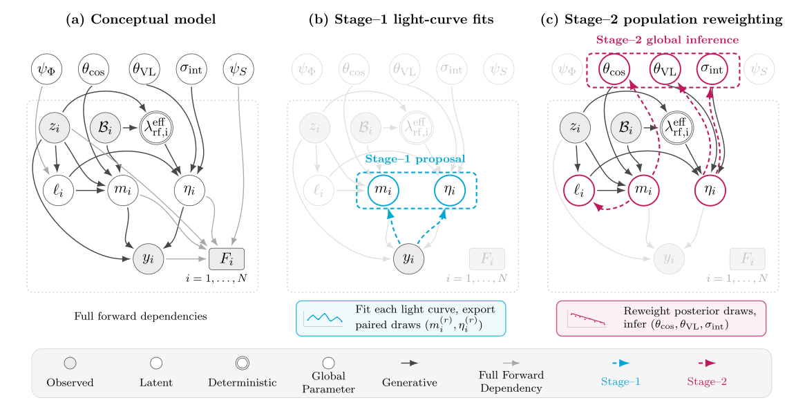
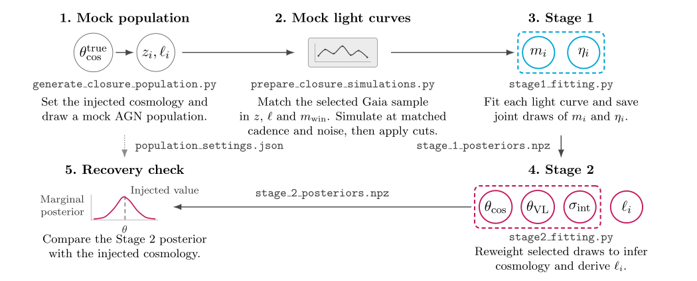

# CosmoVar

*Cosmology from AGN variability*

This repository provides the framework and figure-reproduction code
accompanying [*A hierarchical Bayesian framework for cosmology using Type 1
AGN variability*](https://arxiv.org/abs/2606.28501), with
[data products on Zenodo](#data-and-figures). The framework infers luminosity
distances from the anti-correlation between AGN optical/UV continuum
variability and luminosity, and is tested on simulations matched to Gaia DR3
cadences and noise. It has two stages:

- **Stage 1** fits a damped random walk (DRW) to each light curve independently
  to infer its window-averaged magnitude $m_{\mathrm{win}}$ and rest-frame
  short-lag variability rate $D$ ($\eta = \log_{10} D$).
- **Stage 2** importance-reweights the joint posterior draws of
  $m_{\mathrm{win}}$ and $\eta$ to infer population parameters and relative
  luminosity distances, with the absolute scale requiring external calibration.

[](figures/graphical_model.svg)

*Figure 1. The conceptual model (left), independent Stage-1 light-curve fits
(centre) and Stage-2 population inference (right).*

## Environment

The environment uses Python 3.10. The pinned dependencies can be installed
from the repository root.

```bash
python -m venv .venv
source .venv/bin/activate
python -m pip install -r requirements.txt
```

Local plotting requires LaTeX. The Apptainer image includes Python, the
pinned dependencies, LaTeX and the passband and SED assets. It can be built
from the repository root.

```bash
mkdir -p build
apptainer build build/cosmovar.sif Apptainer.def
```

## Repository layout

```text
CosmoVar/
├── code/
│   ├── framework/          # Sample preparation, simulations and fitting
│   ├── plotting/           # Figure scripts and diagnostic plotting
│   ├── reproduce_figures.py
│   └── verify_data.py
├── examples/               # Worked recovery, selection and closure examples
├── assets/                 # Required SED and passband files
├── figures/                # Diagrams and PSD supporting material
├── zenodo/                 # Data inventories and verification manifests
├── compact_plot_data.tar.gz
├── compact_plot_data.tar.gz.sha256
├── Apptainer.def            # Reproducible container recipe
├── requirements.txt        # Pinned Python dependencies
├── matplotlibrc            # Figure typography and styling
├── README.md
├── CITATION.cff
├── LICENSE
└── .gitignore
```

Run the commands below from the repository root.

## Use the framework

<details id="plot-the-saved-results">
<summary><strong>A. Replot the paper figures.</strong> No Zenodo download is needed.</summary>

The compact archive bundled with this repository contains the numerical
inputs for Figures 2–6. The Zenodo deposit supplies the source-level tables
and saved posterior draws for [exploring the figure data](#explore-the-figure-data-from-zenodo).

```bash
sha256sum -c compact_plot_data.tar.gz.sha256
tar -xzf compact_plot_data.tar.gz
python code/reproduce_figures.py --plot-data plot_data
```

Outputs go to `figures/`. The `--figures` option selects figures, and
`--dry-run` prints the commands.

Apptainer uses the same extracted `plot_data/`.

```bash
mkdir -p figures
apptainer run --cleanenv --containall --no-mount hostfs,cwd \
  --bind "$PWD/plot_data:/plot_data:ro" \
  --bind "$PWD/figures:/opt/agn/figures" \
  build/cosmovar.sif --plot-data /plot_data
```

Figure 1 renders from TikZ.

```bash
PYTHONPATH=code python -m plotting.render_graphical_model
```

This writes `figures/graphical_model.pdf`.

| Figure | Inputs and calculation | Source |
|---:|---|---|
| 1 | Probabilistic graphical model | [graphical_model.tex](figures/graphical_model.tex) |
| 2 | Observed Gaia–SDSS sample summaries | [plot_observed_sample.py](code/plotting/plot_observed_sample.py) |
| 3 | Stage-1 prior sensitivity across Priors 1–5 | [plot_prior_sensitivity.py](code/plotting/plot_prior_sensitivity.py) |
| 4 | Stage-1 fits for observed and simulated light curves | [plot_real_vs_simulated.py](code/plotting/plot_real_vs_simulated.py) |
| 5 | Short-lag cadence support and Stage-1 recovery calibration on the selected mocks | [plot_short_lag_calibration.py](code/plotting/plot_short_lag_calibration.py) |
| 6 | Stage-2 population and cosmological posteriors | [plot_cosmology_closure.py](code/plotting/plot_cosmology_closure.py) |

</details>

<details id="explore-the-figure-data-from-zenodo">
<summary><strong>B. Explore the data.</strong></summary>

The Zenodo downloads contain the following samples and inference results.

| Figure | Sample | Zenodo files |
|---|---|---|
| **2** | 215,985 observed Gaia–SDSS sources in the archived table. | `figure_analysis_tables.tar.gz`<br>`observed_gaia_light_curves.tar.gz` |
| **3** | 33,600 recovery light curves fitted under Priors 1–5, including posterior draws for the Figure 3(b) source. | `figure_analysis_tables.tar.gz`<br>`simulated_light_curves.tar.gz` |
| **4** | 113,138 observed Figure 2 sources and 113,138 calibration mocks. | `figure_analysis_tables.tar.gz`<br>`observed_gaia_light_curves.tar.gz`<br>`simulated_light_curves.tar.gz` |
| **5** | Figure 4 calibration mocks, with truth, cadence, recovery information and a separate selection mask. | `figure_analysis_tables.tar.gz`<br>`simulated_light_curves.tar.gz` |
| **6** | 1.25 million parent candidates and 113,138 closure mocks with shared truth and settings. Stage 1 fits and metadata for Priors 1–5; Stage 2 chains, configurations and selections for Priors 1, 3, 4 and 5. [Closure example](examples/closure_example.py). | `cosmology_closure_parent_population.npz`<br>`cosmology_closure_inputs.tar.gz`<br>`simulated_light_curves.tar.gz`<br>`cosmology_closure_stage1_prior_N.tar.gz` (`N=1`–`5`)<br>`cosmology_closure_stage2.tar.gz` |

Changing the Figure 6 source selection requires a [Stage 2 refit](#regenerate-data-or-refit).

After downloading the figure tables into `zenodo/`, extract and verify them:

```bash
tar -xzf zenodo/figure_analysis_tables.tar.gz -C zenodo
python code/verify_data.py
```

`TABLES.md` in `zenodo/results/figure_analysis/` describes the NumPy arrays.

</details>

<details id="regenerate-data-or-refit">
<summary><strong>C. Regenerate data or refit.</strong></summary>

[](figures/closure_workflow.svg)

Choose an example for your starting point:

- [Gaia–SDSS light curves](examples/reproduce_from_light_curves.py): prepare the
  sample, generate mocks, fit both stages and render figures. Use `--steps`
  to run individual parts.
- [Recovery grid](examples/recovery_grid.sh): a smaller mock-generation and
  Stage 1 example.
- [Saved closure inputs](examples/closure_example.py): rebuild Figure 6 light
  curves and refit both stages. Use `--parent-npz` to reuse the deposited
  parent or `--mocks-only` to skip fitting.
- [Saved Stage 1 draws](examples/refit_stage2.sh): refit Stage 2 on a random
  Prior 5 subsample. Run `bash examples/refit_stage2.sh 1000` for 1,000 sources.
- <a id="psd-example"></a>[PSD robustness tests](examples/psd_steepening.py):
  run the Section 5.1 simulations and fits, or replot their archived tables.

Each Python example lists its inputs and options with `--help`:

```bash
python examples/reproduce_from_light_curves.py --help
```

The main workflow and PSD example print commands by default; add `--execute`
to run them. Full fits require HPC resources. Settings for reproducing the manuscript's main analyses are in
[paper_settings.json](examples/paper_settings.json).

To change the Stage 2 sample, select sources from the full Stage 1 results
and pass their IDs with `--source-id-manifest`.
Fresh fits produce new draws; use the archived products for exact paper figures.

</details>


## Data and figures

The [Zenodo dataset](https://doi.org/10.5281/zenodo.24081156) contains cleaned observed and simulated light curves, source-level figure tables, and full Figure 6 Stage 1 posteriors and Stage 2 chains for Priors 1, 3, 4 and 5. Complete Stage 1 posteriors for Figures 3–5 are available on request owing to deposit size limits, or can be regenerated from the deposited light curves using the code and [worked examples](#regenerate-data-or-refit).

Downloads go in `zenodo/` so that extracting the archives there preserves the expected `results/` and `external_data/` paths. Use `cosmology_closure_parent_population.npz` directly without extracting it. SHA-256 checksums can be verified with:

```bash
mkdir -p zenodo
cd zenodo
sha256sum -c zenodo_checksums.sha256 --ignore-missing
cd ..
```

The [supplementary PSD steepening figure](figures/psd_steepening.pdf) for Section 5.1 is reproduced by [plot_psd_steepening.py](code/plotting/plot_psd_steepening.py), using the paired recovery tables from `psd_steepening_figure.tar.gz` ([plotting instructions](#psd-example)).

## Data provenance

The observed sample combines [SDSS DR16Q](https://www.sdss4.org/dr17/algorithms/qso_catalog/) and Gaia DR3 [G-band epoch photometry](https://cdn.gea.esac.esa.int/Gaia/gdr3/Photometry/epoch_photometry/) with a 0.3 arcsec match; the paper describes the cuts. Survey credits: [ESA/Gaia/DPAC](https://gea.esac.esa.int/archive/documentation/GDR3/Miscellaneous/sec_credit_and_citation_instructions/) and [SDSS-IV](https://www.sdss4.org/collaboration/).

Bundled assets include the [Gaia EDR3 G passband (v2)](https://www.cosmos.esa.int/web/gaia/edr3-passbands) ([Riello et al. 2021](https://doi.org/10.1051/0004-6361/202039587)) and a continuum and emission-line SED grid (`logL3000=45`) adapted from Matthew Temple's [qsogen](https://github.com/MJTemple/qsogen) ([Temple, Hewett & Banerji 2021](https://doi.org/10.1093/mnras/stab2586)).

Author-created simulations and inference results use [CC BY 4.0](https://creativecommons.org/licenses/by/4.0/); Gaia data follow the [ESA data terms](https://www.cosmos.esa.int/web/gaia-users/license).

## Citation

Research using CosmoVar should cite the accompanying paper.

```bibtex
@misc{lagunamiralles2026cosmovar,
  title         = {A hierarchical Bayesian framework for cosmology using Type 1 {AGN} variability},
  author        = {Laguna-Miralles, J{\'u}lia and Belokurov, Vasily and Cranmer, Miles},
  year          = {2026},
  eprint        = {2606.28501},
  archivePrefix = {arXiv},
  primaryClass  = {astro-ph.CO},
  url           = {https://arxiv.org/abs/2606.28501}
}
```
